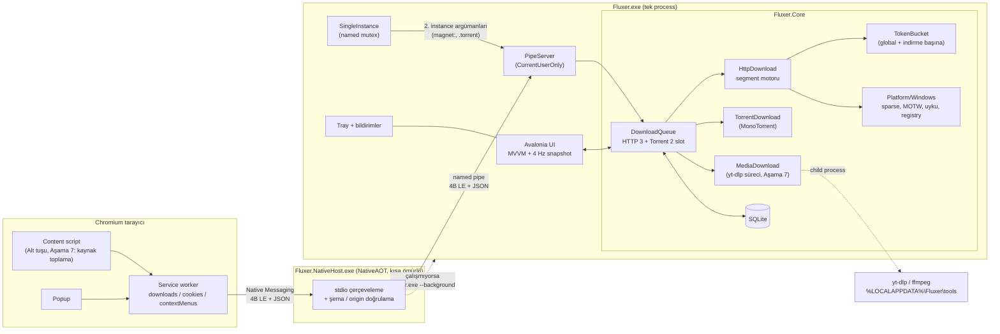

# Fluxer — Mimari (Aşama 0)

> Durum: **Onaylandı ve uygulandı (v0.1.0).** Uygulama sırasındaki sapmalar için §10. Kaynak gereksinimler: `download-manager-prompt.md`.
> Sürümler 2026-10-15'te NuGet/npm üzerinden kontrol edildi.

---

## 1. Bileşen Diyagramı



**Akış özeti (tarayıcı indirmesi):**
`downloads.onCreated` → filtreler (blob/data/POST/eşik/Alt) → `cancel`+`erase` → `sendNativeMessage` → host doğrular → pipe → `DownloadQueue.Add` → `accepted` yanıtı. Host/uygulama ulaşılamazsa eklenti indirmeyi `chrome.downloads.download` ile yeniden başlatır (kendi oluşturduğu ID'yi bir kez yok sayar).

---

## 2. Proje / Klasör Yapısı

```
/src
  Fluxer.Core/                 net10.0-windows
    Downloads/                 IDownload, DownloadState, DownloadQueue, snapshot tipleri
    Http/                      HttpDownload, Segment, SegmentPlanner, ConnectionWorker,
                               TokenBucket, FileNameResolver (RFC 6266), RetryPolicy
    Torrent/                   TorrentDownload, TorrentEngineHost (tek ClientEngine)
    Media/                     MediaDownload, YtDlpRunner, ToolManager   (Aşama 7)
    Storage/                   Database (Microsoft.Data.Sqlite, elle SQL), Migrations.sql
    Platform/Windows/          SparseFile, MarkOfTheWeb, SleepBlocker, RegistryAssociations,
                               FileNameSanitizer, DiskSpace
  Fluxer.Ipc/                  net10.0 — Envelope, mesaj kayıtları, JsonSerializerContext,
                               Framing (4B LE), PipeClient, PipeName
  Fluxer.App/                  net10.0-windows10.0.19041.0 — Avalonia, ViewModels, Views,
                               PipeServer, SingleInstance, Tray, Strings.resx / Strings.tr.resx
  Fluxer.NativeHost/           net10.0, PublishAot=true — yalnızca Fluxer.Ipc'ye bağımlı
  Fluxer.Cli/                  Aşama 1 konsol test aracı (dağıtılmaz)
/extension
  src/background.ts            service worker
  src/content.ts               Alt tuşu (Aşama 7: kaynak toplayıcı)
  src/popup/                   popup
  src/protocol.ts              mesaj tipleri (C# ile birebir)
  _locales/{en,tr}/messages.json
  manifest.json                sabit "key"
/tests
  Fluxer.Core.Tests/           birim: segment bölme, token bucket, dosya adı, sanitize
  Fluxer.Integration.Tests/    Kestrel sahte Range sunucusu, kuyruk, SQLite, pipe
/docs
  ARCHITECTURE.md
CHANGELOG.md
Directory.Build.props          Nullable=enable, TreatWarningsAsErrors, AnalysisLevel=latest
Directory.Packages.props       merkezi paket sürümleri
```

Klasör → proje bölünmesi yalnızca somut ihtiyaçta (prompt kararı). `Fluxer.Cli` istisna: Aşama 1 kabul kriteri konsol uygulaması istiyor.

---

## 3. Kütüphane Seçimleri

| Amaç | Paket | Sürüm (2026-10-15) | Not |
|---|---|---|---|
| UI | Avalonia (+ Fluent tema, Desktop) | 12.1.4 | `TrayIcon` yerleşik |
| MVVM | **CommunityToolkit.Mvvm** (öneri) | 8.4.2 | aşağıya bakın |
| Torrent | MonoTorrent | 3.0.2 | **uTP yok**, bkz. Açık Soru 1 |
| SQLite | Microsoft.Data.Sqlite | 10.0.13 | EF Core yok |
| Log | Serilog + Serilog.Sinks.File | 4.4.0 / 7.0.0 | |
| Kurulum | Velopack | 1.2.161 | |
| Test | xunit.v3 | 4.0.2 | Kestrel: `Microsoft.AspNetCore.App` framework referansı (gerçek soket gerekli; TestHost yetmez) |
| Eklenti | TypeScript / Vite / Vitest / @types/chrome | 7.0.2 / 8.3.4 / 5.0.4 / 0.3.5 | |
| SDK | .NET SDK | 10.0.401 (yüklü) | |

**MVVM seçimi:**

| Seçenek | Artı | Eksi |
|---|---|---|
| **CommunityToolkit.Mvvm** ✅ | Source generator (`[ObservableProperty]`, `[RelayCommand]`), reflection yok, küçük, Avalonia şablonlarının varsayılanı | Rx tarzı akış operatörleri yok (ihtiyacımız da yok) |
| ReactiveUI | Güçlü reaktif kompozisyon | Rx öğrenme eğrisi, daha fazla bağımlılık/RAM, 4 Hz polling modelimizde fayda az |
| Elle `INotifyPropertyChanged` | Sıfır bağımlılık | Boilerplate; generator'ın verdiğini elle yazmak |

---

## 4. Temel Tipler (C# taslakları)

### 4.1 Ortak indirme modeli

```csharp
namespace Fluxer.Core.Downloads;

public enum DownloadKind { Http, Torrent, Media }

public enum DownloadState
{
    Queued, Starting, Downloading, Paused,
    NeedsLinkRefresh,   // 403/410 + redirect yeniden çözümü başarısız
    DiskFull,           // temiz duraklatma + bildirim
    Verifying,          // hash / torrent kontrolü
    Seeding,            // slot kaplamaz
    Completed, Failed,
}

/// HTTP, torrent ve medya indirmelerinin kuyruk/UI'a görünen tek yüzü.
public interface IDownload
{
    long Id { get; }
    DownloadKind Kind { get; }
    DownloadState State { get; }
    string FileName { get; }
    string SaveDirectory { get; }

    /// Kuyruk slotu tüketir mi? (Seeding → false)
    bool OccupiesSlot { get; }

    Task StartAsync(CancellationToken ct);   // kuyruk çağırır
    Task PauseAsync();                        // checkpoint yazıp durur
    Task DeleteAsync(bool deleteFiles);

    /// UI 4 Hz'te yalnızca görünür satırlar için çağırır. Kilitsiz, ucuz olmalı.
    DownloadProgress GetProgress();

    /// Seyrek olay: durum değişimi (Completed/Failed/NeedsLinkRefresh...). Thread pool'dan gelir.
    event Action<IDownload, DownloadState>? StateChanged;
}

public readonly record struct DownloadProgress(
    long BytesDone,
    long? TotalBytes,          // chunked/magnet-metadata öncesi null
    long BytesPerSecond,       // kayan pencere (≈3 sn)
    TimeSpan? Eta,
    int ActiveConnections);    // torrent: peer, medya: fragment
```

> **Tasarım notu:** Motor → UI yönünde ilerleme için olay yağmuru yerine **çekme (pull)** modeli: sayaçlar `Interlocked` ile güncellenir, UI 250 ms'lik `DispatcherTimer` ile yalnızca görünür satırları okur. Böylece "yalnızca görünür satırlar güncellensin" ve "motor UI'a bağımlı değil" gereksinimleri tek mekanizmayla karşılanır. Yalnızca durum geçişleri olaydır.

Detay paneli için tür bazlı ek arayüzler (`IHttpDetails.GetSegments()`, `ITorrentDetails.GetPeers()`) Aşama 5'te eklenir; şimdi yazılmaz.

### 4.2 HTTP segmenti

```csharp
namespace Fluxer.Core.Http;

/// [Start, End) aralığı. Position = sıradaki yazılacak bayt.
/// End yalnızca bölünme ile küçülür; tüm mutasyonlar indirmenin _segmentLock'u altında.
public sealed class Segment
{
    public int Index { get; }
    public long Start { get; }
    public long End { get; internal set; }       // exclusive
    public long Position { get; internal set; }  // Start ≤ Position ≤ End
    public long Remaining => End - Position;
    public bool IsDone => Position >= End;
}

internal sealed class SegmentPlanner(long minSplitBytes /* varsayılan 1 MiB */)
{
    /// İlk plan: totalBytes'ı n eşit parçaya böler.
    public List<Segment> CreateInitial(long totalBytes, int connections);

    /// Boşalan bağlantı için: Remaining'i en büyük segmenti ortadan böler.
    /// Kalan < 2 * minSplitBytes ise null (bağlantı kapanır).
    public Segment? TrySteal(List<Segment> segments);
}
```

**Bölünme semantiği:** Çalışan bağlantı her okumada `min(okunan, End - Position)` kadar yazar; `End` küçüldüyse yanıtı keser. Bağlantılar `Range: bytes=Position-` (açık uçlu) ister, böylece bölünme yeni istek gerektirmez; HTTP/1.1'de yanıtı yarıda kesmek o TCP bağlantısını kapatır (bkz. Risk 3).

### 4.3 Checkpoint ve kalıcılık sırası

```csharp
internal sealed class HttpDownload : IDownload
{
    // ≈2 sn'de bir ve Pause/kapanışta:
    private async Task CheckpointAsync(CancellationToken ct)
    {
        SegmentRow[] snapshot;
        lock (_segmentLock) snapshot = _segments.Select(SegmentRow.From).ToArray();
        FlushFileBuffers(_handle);                 // 1) veri diskte
        await _db.SaveSegmentsAsync(Id, snapshot, ct); // 2) sonra konumlar
    }
}
```

Snapshot flush'tan **önce** alınır: DB'ye yazılan her `Position` diskte kesin olan baytı gösterir. Elektrik kesilirse en kötü ihtimalle son checkpoint'ten sonrası tekrar indirilir.

### 4.4 Hız sınırlayıcı

```csharp
/// Bayt/sn token bucket; limit 0 = sınırsız. Global + indirme başına iki kova sırayla tüketilir.
public sealed class TokenBucket
{
    public long BytesPerSecond { get; set; }
    public ValueTask AcquireAsync(int bytes, CancellationToken ct);
}
```

### 4.5 HTTP istemci ayarları (kritik)

- Tek paylaşılan `SocketsHttpHandler`: `MaxConnectionsPerServer = 32`, `AutomaticDecompression = None` (sıkıştırma Range ofsetlerini bozar), `UseCookies = false` (cookie indirme başına `Cookie` başlığı olarak gönderilir), `AllowAutoRedirect = false` (son URL'yi biz çözüp saklarız).
- Her istek: `Version = HttpVersion.Version11`, `VersionPolicy = RequestVersionExact`.
- Proxy değişince handler yeniden oluşturulur.
- Okuma: bağlantı başına `ArrayPool` ile kiralanmış 1 MiB tampon dolunca `RandomAccess.WriteAsync`.

---

## 5. Mesaj Kontratları

### 5.1 Çerçeveleme

Native Messaging (eklenti ↔ host) ve pipe (host/2. instance ↔ uygulama) **aynı çerçeveyi** kullanır: `uint32 LE uzunluk + UTF-8 JSON`. Host baytları çözmeden doğrulayıp iletebilir; tek `Framing` sınıfı her iki tarafta kullanılır.

| Yön | Sınır |
|---|---|
| Host → eklenti | 1 MiB (Chrome sınırı) |
| Eklenti → host | 4 MiB (bizim sınırımız; Chrome 64 MiB'a izin verir) |
| Pipe | 4 MiB |

Pipe adı: `Fluxer.v1.{kullanıcı SID}`; `PipeOptions.CurrentUserOnly` (ACL'yi .NET kurar ve istemci tarafında sahibi doğrular).

### 5.2 TypeScript (`extension/src/protocol.ts`)

```ts
export const PROTOCOL_VERSION = 1;

export interface Envelope<T extends string, P> {
  protocolVersion: number;
  id: string;          // crypto.randomUUID(); yanıt aynı id ile döner
  type: T;
  payload: P;
}

export interface CookieDto {
  name: string; value: string; domain: string; path: string;
  secure: boolean; httpOnly: boolean; expirationDate?: number;
}

export interface BrowserContext {
  referrer?: string;
  userAgent: string;
  cookies: CookieDto[];
  incognito: boolean;
}

// ---- eklenti → uygulama ----
export type Ping = Envelope<'ping', {}>;

export type DownloadAdd = Envelope<'download.add', BrowserContext & {
  url: string;
  finalUrl?: string;
  fileName?: string;        // tarayıcının önerdiği ad
  mime?: string;
  totalBytes?: number;      // DownloadItem.totalBytes > 0 ise
  source: 'intercept' | 'context-menu';
  tabUrl?: string;
}>;

export type StatusGet = Envelope<'status.get', {}>;

// Aşama 7
export type PageSend = Envelope<'page.send', BrowserContext & { pageUrl: string; title?: string }>;
export type PageResources = Envelope<'page.resources', BrowserContext & {
  pageUrl: string;
  resources: { url: string; kind: 'link' | 'image' | 'media'; width?: number; height?: number }[];
}>;

// 0.7 — açılır pencere: toplu indirme ve uzaktan kontrol
// (eski uygulama 'invalid-message' + 'unknown type' döner → eklenti "güncelleme gerekli" der)
export type DownloadBatch = Envelope<'download.batch', BrowserContext & {
  pageUrl: string;
  items: { url: string; fileName?: string }[];   // yalnızca http(s), 1..1000 → tek ekleme penceresi
}>;
export type Command = Envelope<'command', {
  action: 'pause' | 'resume' | 'remove' | 'open' | 'folder' | 'details' | 'pauseAll' | 'resumeAll' | 'show';
  id?: number;                                   // indirme başına eylemlerde zorunlu; yanıt download.add.result
}>;
// page.send ile yakalanan akış: pageUrl = m3u8/mpd adresi, referrer = videonun oynadığı sayfa → yt-dlp --referer

export type Request = Ping | DownloadAdd | StatusGet | PageSend | PageResources | DownloadBatch | Command;

// ---- uygulama → eklenti ----
export type Pong = Envelope<'pong', { appVersion: string }>;
export type DownloadAddResult = Envelope<'download.add.result', {
  status: 'accepted' | 'rejected';   // rejected → eklenti tarayıcıya geri bırakır
  reason?: string;
}>;
export type Status = Envelope<'status', {
  active: number; queued: number; bytesPerSecond: number;
  top: { name: string; progress: number; bytesPerSecond: number }[]; // en fazla 5
  items?: { id: number; name: string; state: string; kind: string; progress: number;
            bytesPerSecond: number; doneBytes: number; totalBytes?: number }[]; // 0.7: bitmemişler (≤20) + son bitenler (≤8)
}>;
export type ErrorReply = Envelope<'error', {
  code: 'protocol-mismatch' | 'invalid-message' | 'app-unavailable' | 'internal';
  minProtocolVersion?: number;   // protocol-mismatch'te: eklentiyi güncelle uyarısı
  message?: string;
}>;
export type Reply = Pong | DownloadAddResult | Status | ErrorReply;
```

### 5.3 C# (`Fluxer.Ipc`)

```csharp
namespace Fluxer.Ipc;

public static class Protocol { public const int Version = 1; }

/// Payload tipe göre ayrıştırılır (iki aşamalı: önce Envelope, sonra Payload).
public sealed record Envelope(int ProtocolVersion, string Id, string Type, JsonElement Payload);

public sealed record CookieDto(string Name, string Value, string Domain, string Path,
    bool Secure, bool HttpOnly, double? ExpirationDate);

public sealed record DownloadAdd(
    string Url, string? FinalUrl, string? FileName, string? Mime, long? TotalBytes,
    string Source, string? TabUrl,
    string? Referrer, string UserAgent, CookieDto[] Cookies, bool Incognito);

public sealed record DownloadAddResult(string Status, string? Reason);
public sealed record StatusReply(int Active, int Queued, long BytesPerSecond, StatusItem[] Top);
public sealed record StatusItem(string Name, double Progress, long BytesPerSecond);
public sealed record ErrorReply(string Code, int? MinProtocolVersion, string? Message);
public sealed record Pong(string AppVersion);

// Yalnızca pipe: ikinci instance → çalışan instance
public sealed record InstanceArgs(string[] Args);   // type: "instance.args"

[JsonSourceGenerationOptions(PropertyNamingPolicy = JsonKnownNamingPolicy.CamelCase)]
[JsonSerializable(typeof(Envelope))]
[JsonSerializable(typeof(DownloadAdd))]
[JsonSerializable(typeof(DownloadAddResult))]
[JsonSerializable(typeof(StatusReply))]
[JsonSerializable(typeof(ErrorReply))]
[JsonSerializable(typeof(Pong))]
[JsonSerializable(typeof(InstanceArgs))]
public sealed partial class IpcJson : JsonSerializerContext;   // NativeAOT için zorunlu
```

### 5.4 Host davranışı

1. Chrome, host'u çağıran origin'i (`chrome-extension://<id>/`) ilk argüman olarak verir → izin listesinde değilse `error/invalid-message` ve çıkış (manifest'teki `allowed_origins`'e ek savunma).
2. Mesaj okunur, `protocolVersion` ve şema doğrulanır (URL şeması yalnızca `http/https`; `magnet:` sadece `download.add`'de; `download.batch` 1–1000 öğe; `command` bilinen eylem + gerekiyorsa `id`). Uygulamayı yalnızca iş isteyen mesajlar başlatır (`download.*`, `page.*`, `command/show`); durum ve diğer komutlar başlatmaz.
3. Pipe'a bağlanılır; başarısızsa `Fluxer.exe --background` başlatılır, 5 sn boyunca 100 ms aralıkla yeniden denenir; olmazsa `error/app-unavailable`.
4. Yanıt aynen eklentiye döner, host çıkar.

Eklenti `sendNativeMessage` (mesaj başına bir host süreci) kullanır; kalıcı port tutulmaz. Host NativeAOT olduğu için açılış ≈ onlarca ms. Uygulama → eklenti push ihtiyacı v1'de yok.

---

## 6. SQLite Şeması

`PRAGMA journal_mode=WAL; PRAGMA synchronous=NORMAL; PRAGMA foreign_keys=ON;` — şema sürümü `PRAGMA user_version` ile; migration'lar sıralı SQL dizeleri.

```sql
CREATE TABLE downloads (
  id              INTEGER PRIMARY KEY,
  kind            INTEGER NOT NULL,          -- DownloadKind
  state           INTEGER NOT NULL,          -- DownloadState
  file_name       TEXT    NOT NULL,
  save_dir        TEXT    NOT NULL,
  category        TEXT,
  total_bytes     INTEGER,                   -- NULL = bilinmiyor
  done_bytes      INTEGER NOT NULL DEFAULT 0,
  speed_limit     INTEGER NOT NULL DEFAULT 0,-- B/s, 0 = sınırsız
  queue_order     INTEGER NOT NULL,
  error           TEXT,
  created_at      INTEGER NOT NULL,          -- unix ms
  completed_at    INTEGER
);
CREATE INDEX ix_downloads_state ON downloads(state, queue_order);

CREATE TABLE http_downloads (
  download_id     INTEGER PRIMARY KEY REFERENCES downloads(id) ON DELETE CASCADE,
  url             TEXT    NOT NULL,          -- orijinal (redirect yeniden çözümü için)
  final_url       TEXT,
  max_connections INTEGER NOT NULL DEFAULT 8,
  resumable       INTEGER NOT NULL,          -- Range + Content-Length var mı
  etag            TEXT,
  last_modified   TEXT,
  referrer        TEXT,
  user_agent      TEXT,
  cookies         BLOB,                      -- DPAPI (CurrentUser) ile şifreli JSON
  hash_algo       TEXT,                      -- 'MD5' | 'SHA256' | NULL
  hash_expected   TEXT
);
-- Link yenileme eşleşmesi: NeedsLinkRefresh durumundakiler file_name + total_bytes ile aranır.

CREATE TABLE segments (
  download_id     INTEGER NOT NULL REFERENCES downloads(id) ON DELETE CASCADE,
  idx             INTEGER NOT NULL,
  start           INTEGER NOT NULL,
  end             INTEGER NOT NULL,          -- exclusive
  position        INTEGER NOT NULL,
  PRIMARY KEY (download_id, idx)
) WITHOUT ROWID;

CREATE TABLE torrent_downloads (
  download_id     INTEGER PRIMARY KEY REFERENCES downloads(id) ON DELETE CASCADE,
  info_hash       TEXT    NOT NULL UNIQUE,
  magnet          TEXT,
  torrent_file    BLOB,                      -- metadata gelince doldurulur
  fast_resume     BLOB,                      -- MonoTorrent FastResume
  sequential      INTEGER NOT NULL DEFAULT 0,
  seed_ratio      REAL,                      -- NULL = global ayar
  seed_minutes    INTEGER,
  uploaded_bytes  INTEGER NOT NULL DEFAULT 0
);

CREATE TABLE torrent_files (
  download_id     INTEGER NOT NULL REFERENCES downloads(id) ON DELETE CASCADE,
  file_index      INTEGER NOT NULL,
  path            TEXT    NOT NULL,
  selected        INTEGER NOT NULL DEFAULT 1,
  PRIMARY KEY (download_id, file_index)
) WITHOUT ROWID;

-- Aşama 7
CREATE TABLE media_downloads (
  download_id     INTEGER PRIMARY KEY REFERENCES downloads(id) ON DELETE CASCADE,
  page_url        TEXT    NOT NULL,
  format_spec     TEXT    NOT NULL,          -- yt-dlp -f değeri
  title           TEXT,
  cookies         BLOB                       -- DPAPI; geçici Netscape dosyası buradan üretilir
);

CREATE TABLE settings (
  key             TEXT PRIMARY KEY,
  value           TEXT NOT NULL              -- JSON
) WITHOUT ROWID;
-- Kategoriler, uzantı→klasör kuralları, limitler, zamanlayıcı: settings içinde JSON.
-- Ayrı tablo gerekirse (ör. kural sayısı/sorgu ihtiyacı) Aşama 5'te çıkarılır.
```

---

## 7. Aşama Planı (özet)

| Aşama | Teslim | Dokunulan projeler |
|---|---|---|
| 0 | Bu belge | — |
| 1 | HTTP motoru + `Fluxer.Cli` + Kestrel testleri | Core (Http, Platform/Windows, Storage'ın segment kısmı), Cli, tests |
| 2 | Kuyruk, limitler, SQLite, olaylar | Core (Downloads, Storage) |
| 3 | Minimal UI, tray, tek instance, eklenti, host, registry | App, Ipc, NativeHost, extension |
| 4 | Torrent | Core (Torrent), App (ilişkilendirme) |
| 5 | Detay paneli, ayarlar, bildirim, tema, kategori, zamanlayıcı | App |
| 6 | Velopack installer + güncelleme | App (VelopackApp hook'ları), CI script |
| 7 | Sayfa yakalayıcı, yt-dlp/ffmpeg | extension, Core (Media), App |

Kabul kriterleri prompt'taki gibidir; her aşama sonunda `CHANGELOG.md` girdisi + 5–10 satır özet.

---

## 8. Riskler

| # | Risk | Etki | Azaltma |
|---|---|---|---|
| 1 | **MonoTorrent uTP (BEP 29) desteklemiyor** (README'de yok) | Bazı swarm'larda daha az peer | Açık Soru 1 |
| 2 | 1 Gbps hedefi: Defender `.part` dosyasını yazarken tarayabilir | Disk tarafında darboğaz | Ölçüm Aşama 1'de; gerekirse kullanıcıya indirme klasörü dışlama önerisi (otomatik dışlama yapılmaz) |
| 3 | Segment bölününce açık uçlu Range yanıtını kesmek HTTP/1.1 bağlantısını kapatır | Bölünme başına bir TCP+TLS el sıkışması | Bölünme sayısı segment sayısıyla sınırlı (≤ ~2×bağlantı); kabul edilebilir. Gerekirse kapalı aralıklı isteklere geçilir |
| 4 | Küçük dosyada `cancel` yarışı | İndirme hem tarayıcıda hem uygulamada | Prompt kararı: yarış kaybedilirse sessizce tarayıcıya bırak (`state==complete` kontrolü) |
| 5 | POST ile başlayan indirmeler `DownloadItem`'da görünmez | POST yanlışlıkla yakalanır | `webRequest.onBeforeRequest` (gözlem modu, MV3'te izinli) ile son POST URL'leri kısa süre tutulur; eşleşen indirme tarayıcıya bırakılır |
| 6 | Windows toast bildirimleri AUMID + Başlat menüsü kısayolu ister | Aşama 3–5'te bildirim çıkmaz | Velopack kısayolu oluşturur; AUMID kısayola ve process'e aynı atanır. Geliştirme sırasında Avalonia in-app bildirim yedek |
| 7 | Sparse dosya + rastgele sıralı yazma → parçalanma | Bitmiş dosyada hafif okuma yavaşlığı | Kabul (IDM benzeri davranış). `SetFileValidData` admin ister, kullanılmaz |
| 8 | Cookie'ler diskte | Oturum çalınması | DPAPI (CurrentUser) ile şifreli; loglarda maskelenir; tanılama paketine girmez |
| 9 | Host manifest yolu güncellemelerde değişirse entegrasyon kırılır | Eklenti bağlanamaz | Velopack'in sabit `current\` yolu kullanılır; her başlangıçta registry/manifest doğrulanıp gerekirse onarılır |
| 10 | YouTube için yt-dlp ek JS runtime isteyebilir | Aşama 7 kırılır | Prompt gereği Aşama 7 başında doğrulanıp ToolManager'a eklenecek |
| 11 | Avalonia 12 yeni ana sürüm | Bazı 3. parti kontrol paketleri uyumsuz olabilir | Özel kontroller (segment haritası, grafik) zaten kendi çizimimiz; 3. parti kontrol eklenmez |

---

## 9. Açık Sorular

1. **uTP:** Prompt "DHT, PEX, uTP açık" diyor; MonoTorrent 3.0.2 uTP desteklemiyor. Seçenekler:
   - **(a) v1'de uTP yok** — TCP + DHT + PEX + LSD + UPnP/NAT-PMP. Kod değişikliği yok. ✅ *Önerim*
   - (b) libtorrent'e geç (native C++ bağlama) — tam özellik ama büyük bağımlılık, P/Invoke katmanı, "MonoTorrent doğrudan" kararıyla çelişir.
   - (c) uTP'yi kendimiz yazıp MonoTorrent'e eklemek — haftalarca iş, kapsam dışı.
2. **Stage 1 konsol aracı** `src/Fluxer.Cli` olarak dağıtım dışı tutulacak — itiraz yoksa böyle.
3. **Git:** Klasör henüz git deposu değil. Aşama 1'e başlarken `git init` + `.gitignore` öneriyorum.

---

## 10. Uygulama Notları (onaydan sonra verilen kararlar)

| Konu | Karar | Neden |
|---|---|---|
| uTP | v1'de yok (Açık Soru 1, seçenek a) | MonoTorrent desteklemiyor |
| Redirect | `AllowAutoRedirect = true`, son URL `response.RequestMessage.RequestUri`'den | Elle takip gereksizdi |
| Bağlanma | `ConnectCallback` ile IPv6/IPv4 yarışı (RFC 8305, 250 ms) | Bozuk IPv6 rotasında varsayılan handler her isteği ~21 sn bekletiyordu (canlı testte bulundu) |
| Bağlantı açılışı | 150 ms aralıklı slow start, ilk 429'da durur | Ani 8 bağlantı bazı sunucularda geçici IP yasağına yol açtı |
| Worker sayımı | `_activeWorkers` yalnızca segment teslimiyle aynı kilit altında değişir | Eşzamanlı 429'larda son worker'ın da çıkması / sahipsiz segment riski |
| İlerleme | Olay yerine çekme: UI 4 Hz'te yalnızca görünür satırları okur | Tek mekanizma, motor UI'dan bağımsız |
| `IDownload.RunAsync` | `Start/Pause` yerine tek `RunAsync(ct)`; iptal = duraklat | Daha az durum |
| Native host | Mesaj başına süreç (`sendNativeMessage`), NativeAOT | Kalıcı port yok; ~20 ms tur |
| Pipe | `PipeOptions.CurrentUserOnly` + adında kullanıcı SID'i | ACL'yi .NET kurar |
| Dosya çakışması | "Sor" seçeneği v1'de yok (yeniden adlandır / üzerine yaz) | Motor içinden UI sorusu gerektiriyordu |
| Video araçları | yt-dlp + **deno** (YouTube için JS runtime; Aşama 7 başında doğrulandı) + ffmpeg (yt-dlp/FFmpeg-Builds) | yt-dlp.exe EJS'yi içerir, deno'yu aynı klasörde bulur |
| Alt süreçler | yt-dlp/ffmpeg bir Job Object'e (`KILL_ON_JOB_CLOSE`) atanır | Uygulama çökse bile `.part`'a yazan yetim süreç kalmaz |
| Araç indirme | Motorun paylaşılan `HttpClient`'ı (aynı handler/IPv6 yarışı) kullanılır, kuyruğa eklenmez | Listede görünmesi istenmez |
| Kayıt | Registry/manifest her açılışta onarılır (Risk 9) | Taşınan kurulum/yeni tarayıcı |
| Tarayıcı yakalama (0.2) | İptal yerine **duraklat** → Fluxer 64 baytlık yoklama yapar → kabul (tarayıcı iptal eder) ya da ret + `reason` (tarayıcı devam eder) | Cloudflare/tek kullanımlık bağlantı/oturum gerektiren sitelerde Fluxer HTML alıyordu ("…0362.html", 2.118 bayt) |
| Torrent dosyaları (0.2) | Tarayıcı indirir, eklenti biten dosyanın yolunu (`torrentPath`) gönderir, host yalnızca mutlak `.torrent` yolunu kabul eder | Siteye ikinci istek atmadan torrent açmak |
| User-Agent (0.2) | Önce tarayıcı UA'sı; istek düşerse/HTML gelirse kendi UA'mızla tekrar | TLS parmak izi ile UA tutarsızlığını bot sayan sunucular (Hetzner'da ölçüldü) |
| Liste (0.2) | Avalonia DataGrid + `DataGridCollectionView` (filtre/sıralama); 4 Hz yenileme yalnızca çalışan satırlar için | Sütun genişletme/sıralama hazır geliyor |
| Ayarlar (0.2) | Uygulama içi sayfa, 400 ms gecikmeli otomatik kaydetme; görünüm modeli pencere bağlanmadan önce yüklenir | Gizli sayfanın varsayılan kontrol değerlerinin ayarların üzerine yazılması hatası bulundu |
| Görünüm (0.4) | `AppSettings.Ui` + `Services/Appearance`: FluentTheme paleti (vurgu), DensityStyle (sıkı), Mica, `LayoutTransformControl` ile ölçek; geçişler yalnızca `Window.motion` sınıfında | Tek yerden canlı uygulanır; animasyon kapatılınca sınıf kalkar, stiller etkisiz olur |
| Açılış (0.4) | Release'te `PublishReadyToRun`; ayarlar sayfası ilk açılışta oluşturulur | Ölçüm: JIT ~3,1 sn → R2R ~1,3 sn ana pencere hazır |
| Sütun menüsü (0.4) | Başlıkta sağ tuş *bırakma* olayı (handledEventsToo) + menü bir sonraki dispatcher turunda açılır | DataGrid başlığı ContextRequested üretmiyor; bırakma içinde açılan menü aynı tıklamayla kapanıyordu |
| Başlık çubuğu (0.4.1) | `ExtendClientAreaToDecorationsHint` + `WindowDecorationProperties.ElementRole=TitleBar`; Avalonia 12 düğmeleri kendi çiziyor, şablondaki başlık yazısı ve tam ekran düğmesi stil ile gizlendi; ikincil pencerelere şerit `Appearance.ApplyTo` ekliyor | Tek yerden tüm pencereler; Avalonia 12'de ExtendClientAreaChromeHints kaldırıldı |
| Başlık + cam (0.5) | `WindowDecorations=BorderOnly` + kendi başlık düğmelerimiz (ElementRole Min/Max/Close → HTMINBUTTON/HTMAXBUTTON/HTCLOSE, Snap Layouts); min/max stil bitleri geri eklenir; cam = Mica ile açılıp `DWMWA_SYSTEMBACKDROP_TYPE=3` (sistem akrilik) | `Full` modda Windows başlık şeridini opak siyah çiziyordu; Avalonia'nın eski akriliği de o şeridi bulanıklaştırmıyordu |
| Stiller (0.6) | Cam/Mica/Neumorfik/Düz tek ayar (`Ui.Backdrop`); kart kenarı, gölgeler, kart aralığı ve Fluent dolguları `Appearance.ApplyLayers` tarafından kaynak olarak yazılır (`CardEdgeBrush`, `CardShadow`, `RaisedShadow`, `SunkenShadow`, `CardGap`) | Stil değişince yeniden yükleme olmadan canlı uygulanır |
| Tasarım (0.8) | `docs/d-m.html` nihai tasarımı: koyu lacivert degrade + turuncu vurgu varsayılan; renkler `App.axaml` tema sözlüklerinde (`TextBrush`, `SubtleBrush`, `PanelEdgeBrush`, `TrackBrush`, `OkBrush`…), çizgi ikonları `StreamGeometry` + `Controls/Icon`; eski ayarlar `AppSettings.UpgradeDesign()` ile bir kez tasarım varsayılanlarına çekilir | Tek kaynak; açık tema aynı anahtarlarla |
| Hız profilleri (0.8) | 3 profil (`AppSettings.Profiles`); etkin profil `UseProfile` ile `HttpLimit`/`TorrentDownloadLimit`/`TorrentUploadLimit`/`HttpSlots`'a kopyalanır, bu alanlar ayarlarda ayrıca düzenlenmez | Durum çubuğu, haftalık ızgara ve ayarlar aynı yoldan geçer |
| Haftalık zamanlayıcı (0.8) | 168 haneli dize (Pzt 00:00'dan başlar, hane = profil); `AppHost.RunWeekSchedule` yalnızca hücre değişince profil uygular | Elle seçilen profil bir sonraki hücre değişimine kadar korunur |
| Gece kuyruğu (0.8) | Ayrı kuyruk motoru yok: `DownloadState.Scheduled` (10); `ScheduleStart` saatinde `Queue.StartNight()` hepsini `Queued` yapar; eklentiden `download.add` + `queue: "night"` | Mevcut kuyruk ve slot mantığı aynen kullanılır |
| Silme (0.8) | Araç çubuğu/Delete: listeden kaldır + 6 sn "Geri al"; motor kaydı süre dolunca (ya da çıkışta) siler; dosyalarıyla silme bağlam menüsünde | Yanlışlıkla silmeye karşı onay penceresinden daha hızlı |
| Liste çubukları (0.8) | Satırlarda `ProgressBar` yerine hafif `Controls/Bar` | DataGrid hücresinde ProgressBar ızgara sütununa uymuyor, bir de şablonu ağır |
